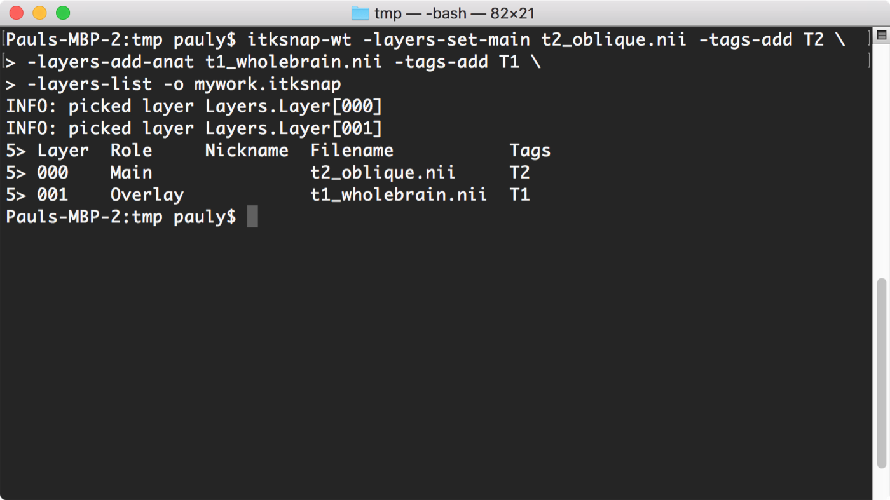
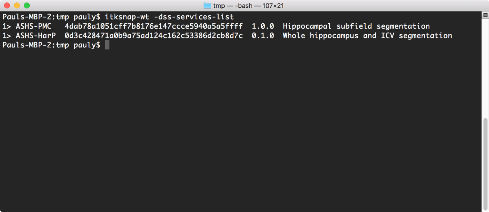
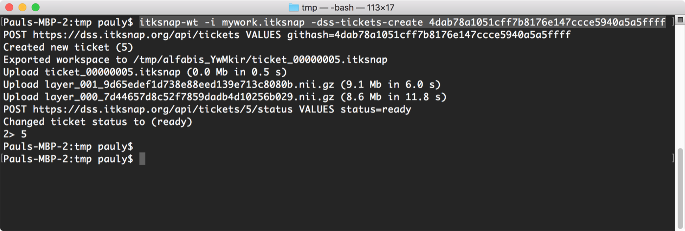
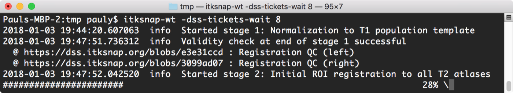
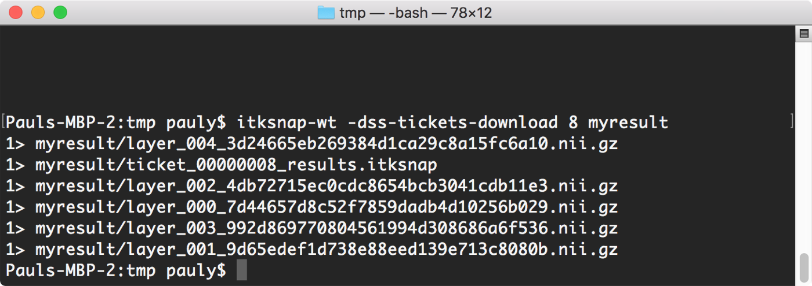

# Cloud ASHS Command-Line Tutorial

This tutorial assumes that you are using the ASHS-PMC atlas. Make sure that your [MRI data is compatible](../mri-data/pmc-atlas.md) with this atlas. The procedure is nearly identical for other ASHS atlases based on the combination of T2-weighted and T1-weighted MRI.

## 1. Create an ITK-SNAP workspace

To send your images to the cloud, you need to create an ITK-SNAP workspace that contains the T2-weighted and T1-weighted images. Here we create the workspace using command-line tools. You can also create the workspace using the [ITK-SNAP GUI](t2-mri.md).

We assume that your MRI scans are named `t2_oblique.nii` and `t1_wholebrain.nii` and that these files are in the current directory.

Enter the following command to create a workspace containing these files:

```bash
itksnap-wt -layers-set-main t2_oblique.nii -tags-add T2-MRI \
           -layers-add-anat t1_wholebrain.nii -tags-add T1-MRI \
           -layers-list -o mywork.itksnap
```

This command adds the T2 image to a blank workspace and assigns it the tag "T2-MRI", then adds the T1 image as an additional image and assigns it the tag "T1-MRI", prints out the contents of the workspace, and finally saves the workspace to a file called `mywork.itksnap`.

<figure markdown>

</figure>

## 2. Obtain a login token for ITK-SNAP DSS

Before you can send tasks to the Distributed Segmentation Service (DSS), you need to authenticate. First, enter this command:

```bash
itksnap-wt -dss-auth https://dss.itksnap.org
```

Then follow the link printed on the command line, log in using your Google account, and paste the token from the web page back into the command-line prompt.

## 3. Create a ticket for Cloud ASHS

Run the command below to list the services currently available on the cloud:

```bash
itksnap-wt -dss-services-list
```

The listing of the services (see figure) includes the service name, version, description, and a unique code in the second column that identifies each service. Select and copy the code for the ASHS-PMC service (if there are multiple versions, choose the latest one).

The following command sends the workspace to the cloud and creates a numbered "ticket". In place of `[service_code]`, paste the unique code of the ASHS-PMC service.

```bash
itksnap-wt -i mywork.itksnap -dss-tickets-create [service_code]
```

- It may take a minute or two for the workspace to be uploaded to the server
- If successful, the number of the ticket will be printed after the `2>` prompt

<div class="fig-row" markdown>
<figure markdown>

<figcaption>Listing the available services.</figcaption>
</figure>
<figure markdown>

<figcaption>Creating a ticket (this ticket has number 5).</figcaption>
</figure>
</div>

## 4. Monitor ticket status

Once a ticket is created, the easiest way to monitor its status is with the following command:

```bash
itksnap-wt -dss-tickets-wait [ticket-id]
```

- This command does not return until the ticket has finished running.
    - If you want the command to return immediately, enter `0` after the ticket ID.
    - You can always interrupt the command with ++ctrl+c++. Doing so does not interrupt the processing of your ticket, only the command that monitors progress.
- The command shows log messages and links to image attachments that you can view to see intermediate ASHS results
- You can submit additional tickets while a ticket is being processed

<div class="fig-row" markdown>
<figure markdown>

<figcaption>Output of the <code>-dss-tickets-wait</code> command.</figcaption>
</figure>
<figure markdown>

<figcaption>Following one of the links shows intermediate results (registration between the ASHS template, T1-MRI and T2-MRI).</figcaption>
</figure>
</div>

## 5. Download ASHS segmentation results

Once a ticket completes successfully, you can download the results as an ITK-SNAP workspace. Specify the directory where the new workspace should be placed:

```bash
itksnap-wt -dss-tickets-download [ticket-id] [directory]
```

The workspace is saved as a `ticket_XXXX.itksnap` file that can be opened in the ITK-SNAP GUI.

<figure markdown>

<figcaption>Output of the download command.</figcaption>
</figure>

## 6. Examine ASHS results

The easiest way to examine ASHS results is to load the downloaded workspace into ITK-SNAP. The workspace contains multiple segmentation layers, which you can access using the Layer Inspector in ITK-SNAP. See the table below for an explanation.

<figure markdown>

<figcaption>The three ASHS segmentation results and when to use each one.</figcaption>
</figure>

<figure markdown>

<figcaption>Viewing segmentation results in ITK-SNAP.</figcaption>
</figure>
