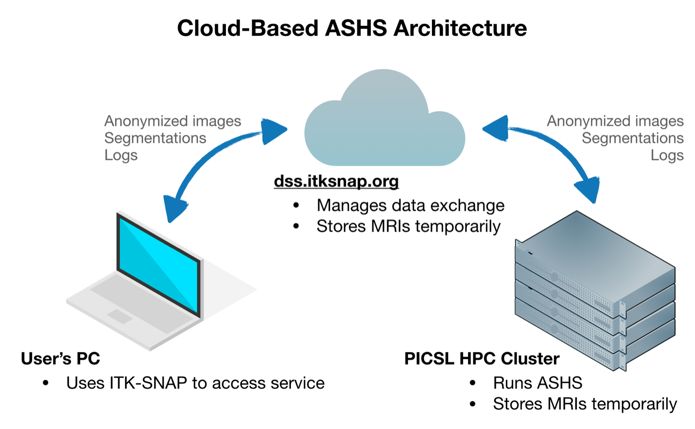

# Cloud ASHS: Overview

The easiest way to try out ASHS with an existing atlas is through our web-based system. Your images are anonymized, encrypted and sent to a secure server, where they are processed on a Linux cluster at the Penn Image Computing and Science Laboratory (PICSL) at the University of Pennsylvania. This service is currently provided for free.

## Requirements

- You will need to install [ITK-SNAP](http://www.itksnap.org/pmwiki/pmwiki.php?n=Downloads.SNAP3) 3.8 or later
- You need a Google account (e.g., Gmail) to log in to the server
- Your data must be compatible with one of the atlases available on the system

## GUI or command line?

The easiest way to run ASHS is with the graphical user interface (GUI) in ITK-SNAP. With just a few clicks you can send your images to the server for processing. Follow one of the tutorials below, depending on what kind of MRI data you want to segment:

- [Cloud ASHS GUI tutorial: hippocampal subfields from T2-weighted and T1-weighted MRI](t2-mri.md)
- [Cloud ASHS GUI tutorial: medial temporal lobe subregions from T1-weighted MRI only](t1-mri.md)

If you need to process several datasets from a script, it is better to use the command-line tool **itksnap-wt**, which is installed as part of ITK-SNAP. Follow the tutorial below:

- [Cloud ASHS command-line tutorial](command-line.md)

For large projects, please [install ASHS locally](../local/installation.md). Our server is currently set up to handle only a moderate number of requests.

<figure markdown>

</figure>
