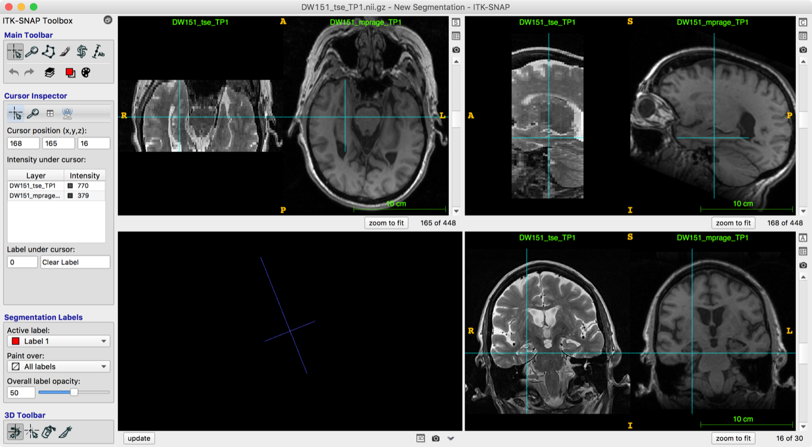
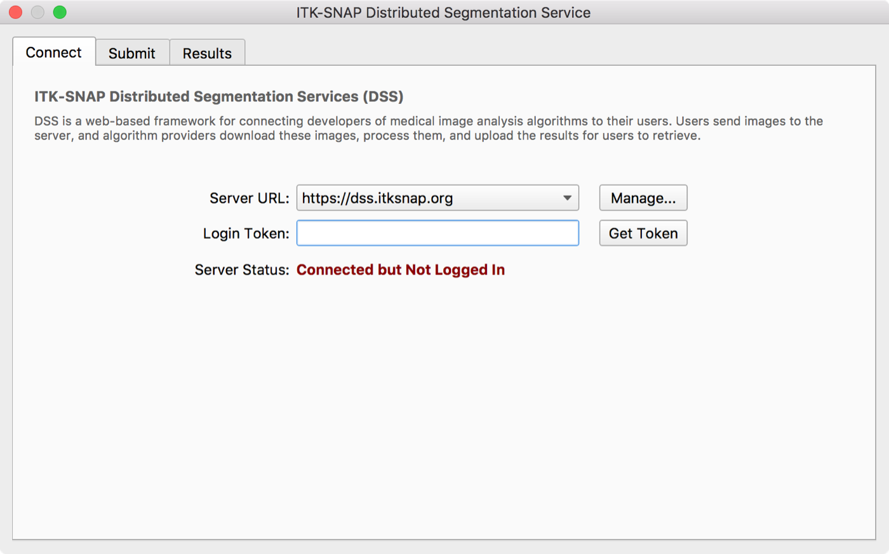
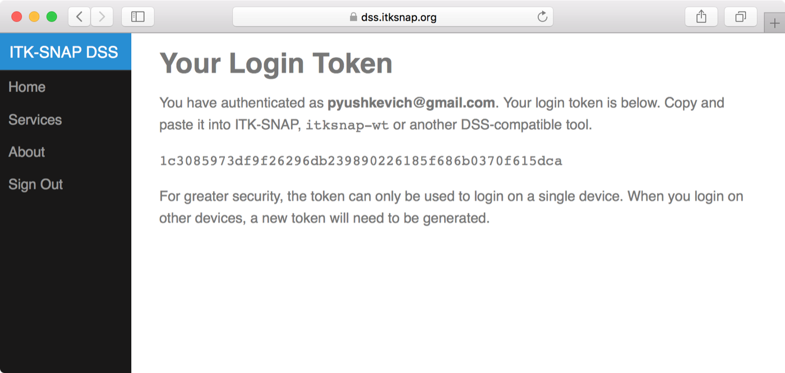
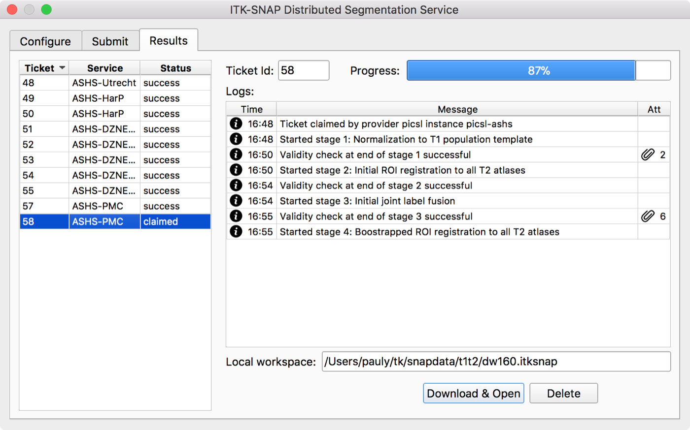
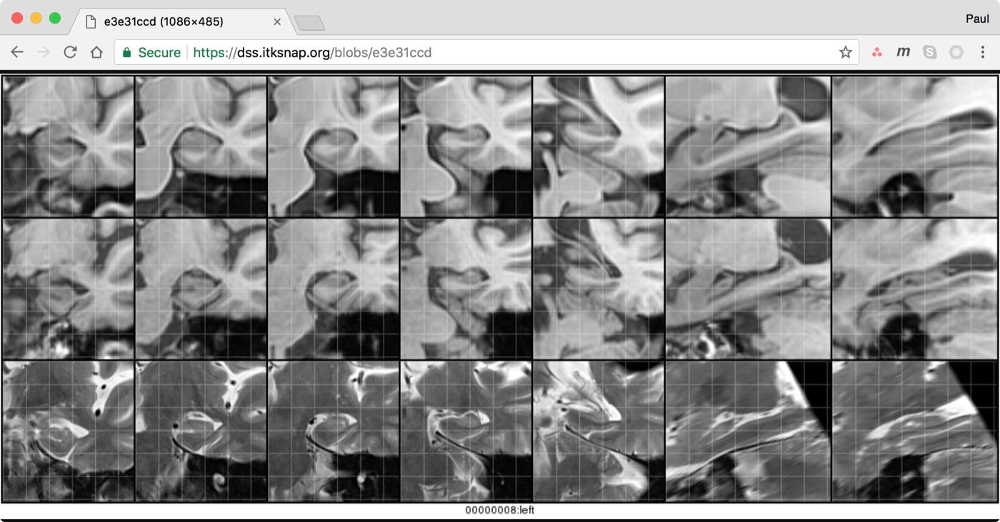
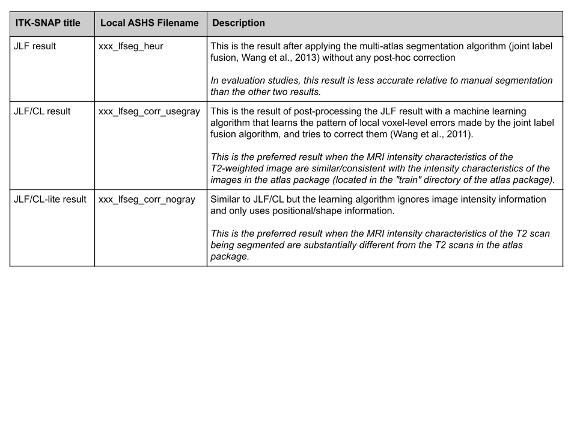
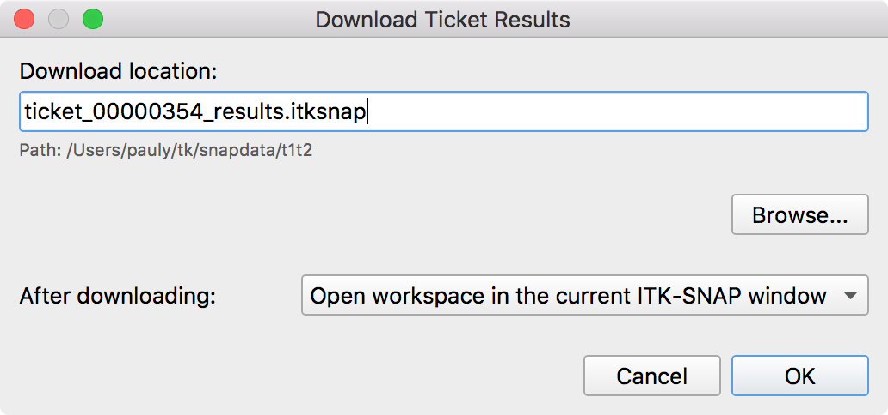
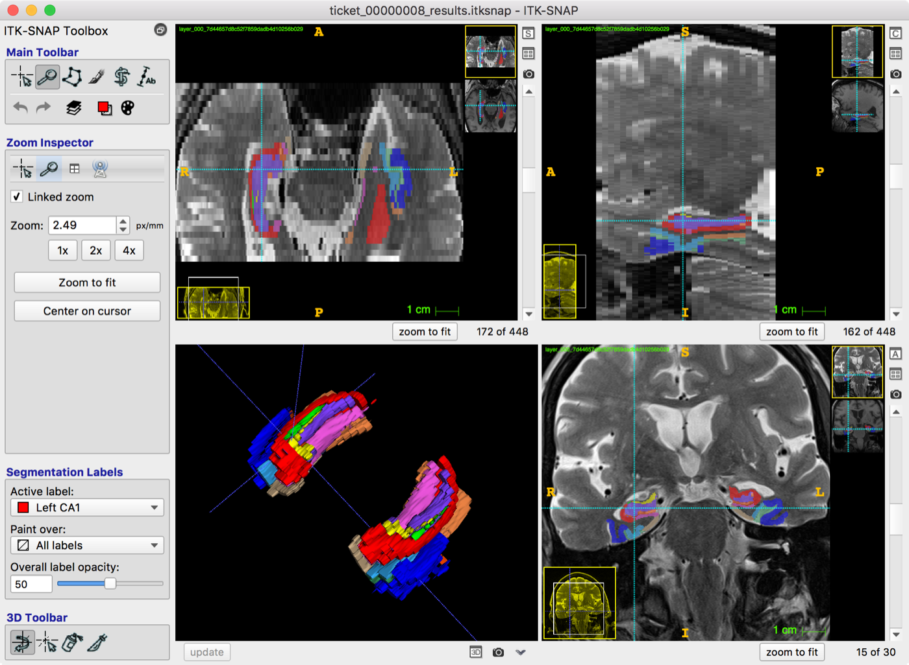

# Cloud ASHS Tutorial: T2-MRI

This tutorial assumes that you are using the ASHS-PMC atlas. Make sure that your [MRI data is compatible](../mri-data/pmc-atlas.md) with this atlas. The procedure is nearly identical for other ASHS atlases based on the combination of T2-weighted and T1-weighted MRI.

!!! note
    To use this service, you need [ITK-SNAP](http://www.itksnap.org/pmwiki/pmwiki.php?n=Downloads.SNAP3) 3.8 or later.

## 1. Create an ITK-SNAP workspace

To send your images to the cloud, you need to create an ITK-SNAP workspace that contains the T2-weighted and T1-weighted images.

- Open ITK-SNAP
- Use `File->Open Main Image...` to load the **T2-weighted image** as the main image
- Use `File->Add Another Image...` to load the **T1-weighted image** as the secondary image
- If the T2 and T1-weighted MRI scans are poorly aligned, perform registration using the interactive tools (`Tools->Registration`)
    - See also the [ITK-SNAP registration video](https://www.youtube.com/watch?v=RT_M_EPzdyY)
- Save the ITK-SNAP workspace to a file using `Workspace->Save Workspace`

<figure markdown>

<figcaption>ITK-SNAP with a T2-weighted image loaded as the main image and the T1-weighted image loaded as the additional image.</figcaption>
</figure>

## 2. Log in to the Distributed Segmentation Service (DSS)

Next, you need to log in to the DSS server. This requires a Google account.

- Open the DSS window using `Tools->Distributed Segmentation Service`
- Select the "Connect" tab if it is not already selected
- Press the **Get Token** button. This opens a web browser at the DSS login page, shown below.
    - Follow the login prompts on the website. Once you log in with your Google account, you will see a 40-character **login token**. Copy the token and paste it back into ITK-SNAP.
- The ITK-SNAP DSS window should show an updated status, in green, indicating that you have logged in
    - The next time you open ITK-SNAP on the same device, your login information will be remembered and you will not need to repeat the token-based login.

<figure markdown>

<figcaption>The ITK-SNAP DSS window, configuration tab. Press "Get Token" to log in.</figcaption>
</figure>
<figure markdown>

<figcaption>The login web page. Paste the token into ITK-SNAP.</figcaption>
</figure>

## 3. Upload your workspace and create a ticket

In this step, you send your workspace to the cloud for segmentation with ASHS.

- Select the "Submit" tab in the ITK-SNAP DSS window
- Select the service you wish to use. In this example, we use the ASHS-PMC service. The image specifications for this service are described [here](../mri-data/pmc-atlas.md).
- In the table of "tags", make sure that the correct images are assigned to the "T2-MRI" and "T1-MRI" tags
    - Ignore the AC/PC landmarks in the table. These are not yet supported.
- Press **Submit**. The workspace will be uploaded to the server and a new ticket will be created.

## 4. Monitor ticket status

Once a ticket is created, the DSS window switches to the "Results" tab, where you can monitor the progress of your ticket. While the ticket is being processed, you can close ITK-SNAP or submit additional tickets.

- Your ticket is highlighted in the list of tickets on the left of the window, and its progress is shown on the right.
- Note the status of your ticket:
    - **ready**: the ticket has been uploaded and is in the queue to be processed
    - **claimed**: the ticket is being processed
    - **success**: the ticket was processed successfully and results are available
    - **failed/timed out**: an error occurred while servicing the ticket
- Once your ticket is in the **claimed** state, log messages show the progress of the ASHS segmentation. Some log messages have attachments in the form of QC (quality control) images. Click the attachment button to list the attachments and open them in a web browser.
- To abort ticket processing, press the **Delete** button

<figure markdown>

<figcaption>Monitoring ticket progress in the DSS window.</figcaption>
</figure>
<figure markdown>

<figcaption>Clicking on one of the attachments shows intermediate results (registration between the ASHS template, T1-MRI and T2-MRI).</figcaption>
</figure>

## 5. Download and examine ASHS results

Once a ticket completes successfully, you can download the results as an ITK-SNAP workspace.

- Select a ticket that is in the **success** state and press the **Download** button
    - A dialog like the one shown below will appear.
    - Choose where to save the result workspace and whether to open it after downloading.
- The workspace contains multiple segmentation layers. You can access the different segmentation layers using the Layer Inspector in ITK-SNAP (`Tools->Layer Inspector`).
    - Use the ++braces-left++ and ++braces-right++ keys to switch between segmentation layers quickly
    - See the table below for an explanation of each layer.

<figure markdown>

<figcaption>The three ASHS segmentation results and when to use each one.</figcaption>
</figure>

<figure markdown>

<figcaption>After pressing "Download", select where the result workspace will be saved, and whether to open it.</figcaption>
</figure>
<figure markdown>

<figcaption>Viewing segmentation results in ITK-SNAP.</figcaption>
</figure>

