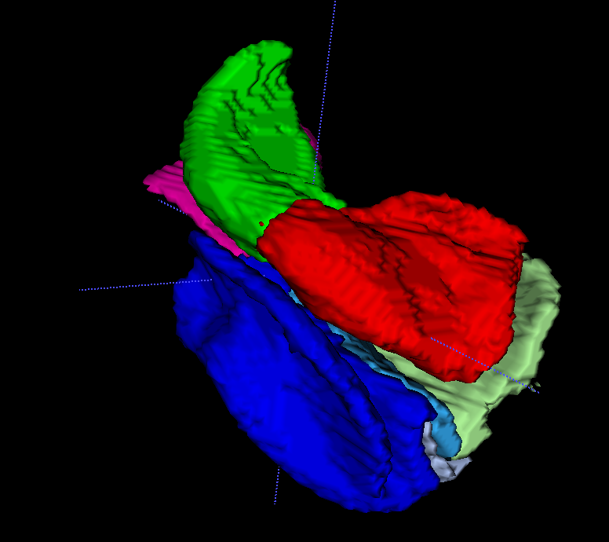

# ASHS Classic

ASHS (Automatic Segmentation of Hippocampal Subfields) is software for automatic segmentation of the medial temporal lobe (MTL) substructures from brain MRI scans. These structures are involved in early Alzheimer's disease and in a number of other neurological conditions. They are also important in research on memory and cognition.

- Automatically labels hippocampal subfields in T2-weighted MRI, or anterior/posterior hippocampus in T1-weighted MRI.
- Automatically labels subregions of the MTL cortex, including entorhinal cortex, perirhinal cortex and parahippocampal cortex, in both T1-weighted and T2-weighted MRI scans.
- Leverages advanced label fusion approaches for multi-atlas segmentation.
- Can be easily retrained to use your own segmentation protocol.
- Free, open-source software.
- Runs on any computer through [Cloud ASHS](cloud/index.md), or locally on Linux and MacOS.

<figure markdown>

<figcaption>Segmentation of hippocampal subfields and MTL subregions by ASHS (3D rendering) from T2-weighted MRI.</figcaption>
</figure>
<figure markdown>

<figcaption>Segmentation of anterior/posterior hippocampus and MTL subregions by ASHS from T1-weighted MRI.</figcaption>
</figure>

## Getting started

-   **[Quick Start](quick-start.md)**

    Pick an atlas, check your MRI data and choose how to run ASHS.

-   **[Cloud ASHS](cloud/index.md)**

    Send your scans to our server from ITK-SNAP. No installation needed.

-   **[Local ASHS](local/installation.md)**

    Install ASHS on a Linux or MacOS workstation or cluster.

-   **[Build your own atlas](local/atlas-t2.md)**

    Train ASHS on your own manual segmentation protocol.

## About us

ASHS is developed by members of the [Penn Image Computing and Science Laboratory (PICSL)](https://picsl.upenn.edu/) in the Department of Radiology at the University of Pennsylvania. Please see [Citations](../resources/citations.md) for authorship information.
