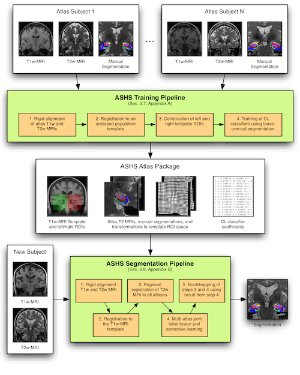
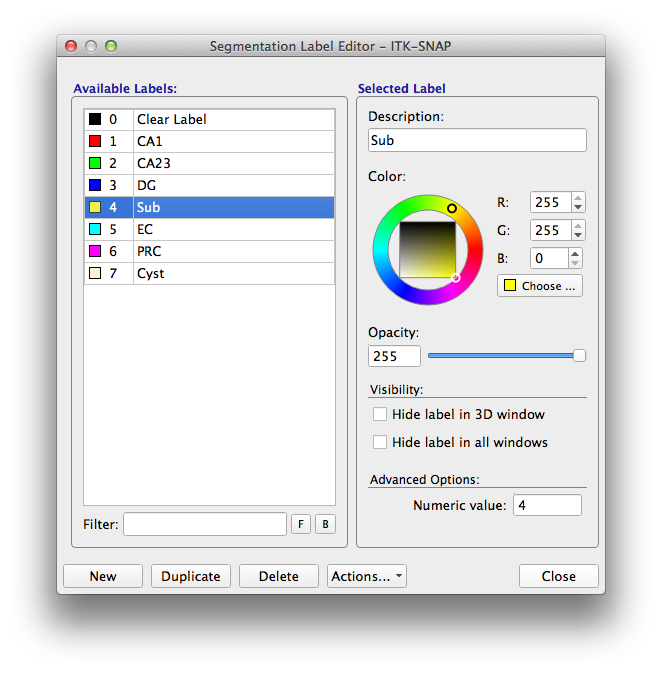

# Building an Atlas for T2-MRI

## Overview

The figure below shows how the ASHS software is organized. The previous sections of this tutorial ran the ASHS segmentation pipeline with one of the atlases provided by the ASHS team. Each atlas package uses a specific segmentation protocol and is optimized for a specific MRI protocol. That is fine for many users, but some may want to use ASHS to label MRI scans following another segmentation protocol. The ASHS training pipeline makes that possible.

<figure markdown class="fig-narrow">

<figcaption>Organization of the ASHS software: the training pipeline builds an atlas package from manually segmented subjects, and the segmentation pipeline applies it to new subjects.</figcaption>
</figure>

## Required data

In this tutorial, we use the ASHS training pipeline to build a new atlas package. As the diagram above illustrates, you need a set of 20 or so manually segmented MRI scans with:

- T1-weighted whole-brain MRI for each subject in NIfTI format
- T2-weighted oblique coronal MRI for each subject in NIfTI format
- Manual segmentation of the structures of interest in the T2-MRI in NIfTI format
    - Each voxel should be assigned a numerical label, with label 0 representing background. For example, CA1=1, DG=2, and so on.

A Linux cluster with Sun Grid Engine (SGE) is **required** to build an ASHS atlas package. Building a package is a time-consuming process that may take a day or so on a cluster, and would take weeks or months on a personal workstation.

### How many subjects?

There is no definitive answer to this question yet. However, our experience suggests that you should include 20–30 subjects to achieve good results. If you plan to study a heterogeneous population (e.g., some controls and some patients), it is best to include representative examples from each group in the atlas set.

For optimal performance, your cluster should be able to run twice as many jobs in parallel as there are subjects. For example, 20 subjects and 40 parallel cores will give good performance. With 21 subjects and 40 cores, however, time will not be used optimally, since there will be periods when only 2 cores are in use.

## Preparing the data

All the input images should satisfy the requirements described in [MRI Data](../mri-data/index.md).

Building an atlas package also requires the following files, each described below:

1. Data manifest file (required)
2. Label description file (required)
3. Configuration file (optional)
4. Slice heuristics file (optional)
5. Cross-validation file (optional)

### Data manifest file

The data manifest file is a text file that describes the data used to build the atlas. Each row corresponds to one subject and contains 5 entries, separated by spaces:

1. Subject ID (no spaces)
2. Path to the T1-weighted MRI in NIfTI format
3. Path to the T2-weighted MRI in NIfTI format
4. Path to the left MTL segmentation in NIfTI format
5. Path to the right MTL segmentation in NIfTI format

No entry may contain spaces. Here is an example manifest file:

```text
XZY001 data/xzy001_t1.nii data/xzy001_t2.nii seg/xzy001_l.nii seg/xzy001_r.nii
XZY002 data/xzy002_t1.nii data/xzy002_t2.nii seg/xzy002_l.nii seg/xzy002_r.nii
```

To avoid errors, we recommend using full paths in the manifest file (the example above uses relative paths for brevity).

### Label description file

The label description file specifies the names of the anatomical labels used in your protocol, as well as the colors used when generating figures. The best way to create this file is with ITK-SNAP:

1. Load your T2-weighted MRI in ITK-SNAP (`File->Open Image`)
2. Load your left or right segmentation (`Segmentation->Open Segmentation`)
3. Open the label editor (`Tools->Label Editor`)
4. Specify a name and a color for each of the labels used in your segmentation
5. Save your labels to a file (`Segmentation->Export Label Descriptions`)

<figure markdown class="fig-narrow">

<figcaption>The ITK-SNAP label editor.</figcaption>
</figure>

The saved label description file should look like this:

```text
################################################
# ITK-SnAP Label Description File
# File format:
# IDX   -R-  -G-  -B-  -A--  VIS MSH  LABEL
# Fields:
#    IDX:   Zero-based index
#    -R-:   Red color component (0..255)
#    -G-:   Green color component (0..255)
#    -B-:   Blue color component (0..255)
#    -A-:   Label transparency (0.00 .. 1.00)
#    VIS:   Label visibility (0 or 1)
#    IDX:   Label mesh visibility (0 or 1)
#  LABEL:   Label description
################################################
    0     0    0    0        0  0  0    "Clear Label"
    1   255    0    0        1  1  1    "CA1"
    2     0  255    0        1  1  1    "CA23"
    3     0    0  255        1  1  1    "DG"
    4   255  255    0        1  1  1    "Sub"
    5     0  255  255        1  1  1    "EC"
    6   255    0  255        1  1  1    "PRC"
    7   255  239  213        1  1  1    "Cyst"
```

Alternatively, you can create a file in the same format with a text editor.

!!! note "Handling left vs. right"
    In our lab, we use the same labels for the left and right structures, so left CA1 and right CA1 both have label 1. If you prefer to assign different labels to left and right structures, you may. ASHS should still work.

### Configuration file (optional)

The configuration file can be used to tune ASHS to your own data. You should not need your own configuration file if your images have resolution and dimensions comparable to those used in the ASHS-provided atlas packages, i.e.:

- T2-MRI has ~0.4 × 0.4 × 2.0 mm³ resolution and 20–40 slices
- T1-MRI has ~1.0 × 1.0 × 1.0 mm³ resolution and covers the whole brain
- Structures are < 5 cm³ in volume

However, if your images are much larger than that, you may need to override some settings. To do so, copy the configuration file from the ASHS `bin` directory and edit the entries to suit your situation. The entries are documented in the file itself.

```bash
cp $ASHS_ROOT/bin/ashs_config.sh work/my_ashs_config.sh
```

Here [is an example](https://sites.google.com/site/hipposubfields/building-an-atlas/ashs-config-script-example) of a configuration file used for a dataset with very large, nearly isotropic T2-weighted images, with ~0.4 × 0.4 × 0.4 mm³ resolution.

### Slice heuristics file (optional)

Because the T2 images used by ASHS tend to be highly anisotropic, some segmentation protocols include additional heuristic rules. For example, we may choose to label the subfields only in the body of the hippocampus, while all voxels in the head and tail of the hippocampus are assigned a summary head/tail label. This is the case for the VACIND atlas package provided with ASHS. A heuristics file specifies rules that the labels on each T2-MRI slice should satisfy. Example rules are:

- Label HEAD and label CA1 should not appear on the same MRI slice
- Label ERC should not appear more than one slice posterior of label HEAD
- If the number of voxels assigned label ERC on a slice is less than 20% of the median number of such voxels across all slices, then ERC voxels on that slice should be assigned the background label instead

Rules are specified using a specific syntax. Please see the [rule syntax documentation](https://sites.google.com/site/hipposubfields/building-an-atlas/heuristic-rule-syntax) for details and examples.

### Cross-validation file (optional)

During atlas generation, you may choose to perform cross-validation to measure segmentation accuracy. Cross-validation is invoked with the `-x` option to `ashs_train`. When using this option, you must supply a file that specifies which subjects are treated as test subjects in each cross-validation experiment.

Notes:

- Cross-validation involves leave-K-out segmentation of the input datasets. Some of the registrations between input datasets performed during atlas building are reused during cross-validation.
- Cross-validation can take as much time as atlas building, or more.
- Cross-validation statistics (overlaps, etc.) are not generated by `ashs_train` and must be computed by the user.

The cross-validation file is a text file. Each row corresponds to one cross-validation experiment, and contains the IDs of the subjects used as test subjects in that experiment. For simple leave-one-out cross-validation, provide a file with the ID of each subject on a separate row:

```text
xzy001
xzy002
...
```

For leave-five-out cross-validation, the file would look like this:

```text
xzy001 xzy023 xzy025 xzy039 xzy042
xzy007 xzy011 xzy015 xzy026 xzy041
...
```

## Building the atlas

To build the atlas, run the command `ashs_train.sh`. We recommend writing a small bash script that runs the command (let's call it `runme.sh`). This way you can re-run `ashs_train.sh` later without retyping all the parameters. Here is an example script:

```bash
#!/bin/bash
# Script for running ASHS training pipeline
$ASHS_ROOT/bin/ashs_train.sh \
  -D manifest.txt \
  -L snaplabels.txt \
  -w /home/pauly/work/ashs/testatlas \
  -Q \
  | tee ashs_train.log
```

This script runs the program with the minimal set of required options:

- `-D` specifies the manifest file
- `-L` specifies the label description file
- `-w` gives the working directory where the atlas will be created
- `-Q` specifies that atlas building runs in parallel on a cluster that uses the Grid Engine (qsub) scheduling system

To provide your own configuration, heuristic rules and cross-validation files, use the options `-C`, `-r` and `-x`, respectively. For example:

```bash
#!/bin/bash
# Script for running ASHS training pipeline
$ASHS_ROOT/bin/ashs_train.sh \
  -D manifest.txt \
  -L snaplabels.txt \
  -w /home/pauly/work/ashs/testatlas \
  -Q \
  -C my_config.sh \
  -r my_rules.txt \
  -x my_xval.txt \
  | tee ashs_train.log
```

To see a full listing of options, call:

```bash
$ASHS_ROOT/bin/ashs_train.sh -h
```

Now use `nohup` to launch your script:

```bash
nohup bash ./runme.sh &
```

## Examining the output and using the atlas

When atlas building completes, the working directory should contain the folder `final`. Inside that folder you should see the following files and directories:

```console
$ ls -l final
drwxr-xr-x  4 pauly jboss   29 Jul 23  2013 adaboost
-rw-r--r--  1 pauly jboss   36 Jul 23  2013 ashs_atlas_vars.sh
-rw-r--r--  1 pauly jboss 7403 Jul 17  2013 ashs_system_config.sh
-rwxr-xr-x  1 pauly jboss  132 Jul 17  2013 ashs_user_config.sh
drwxr-xr-x  2 pauly jboss   64 Aug  2  2013 ref_hm
drwxr-xr-x  2 pauly jboss   38 Sep 12  2013 snap
drwxr-xr-x  2 pauly jboss 4096 Apr 16 12:24 template
drwxr-xr-x 31 pauly jboss 4096 Jul 23  2013 train
```

The contents of the `final` directory should take up several gigabytes (depending on the number and size of the input images). Run the following command to check that everything is there:

```console
$ du -h --max-depth=1
58M     ./template
12M     ./ref_hm
2.0G    ./train
4.0K    ./snap
1.4M    ./adaboost
2.1G    .
```

If the sizes of your subdirectories look very different, check the output for errors.

The `final` directory and its contents constitute the atlas package. You can pass the path to the `final` directory to `ashs_main` to segment new datasets with your atlas package. This is the best way to test whether package building worked.
