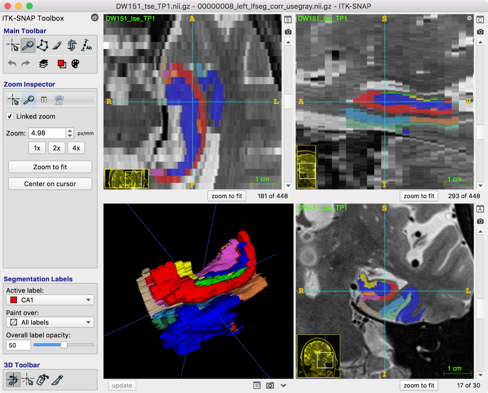

# Local ASHS: Basic Usage

!!! info "Before you start"
    Complete the [installation tutorial](installation.md) and make sure that your [MRI data is compatible](../mri-data/index.md) with ASHS.

## Overview

This tutorial uses one of the existing ASHS atlas packages to perform medial temporal lobe subregion segmentation. It assumes that ASHS has been [installed on your system](installation.md), and that the environment variable `ASHS_ROOT` points to the root of the ASHS installation. To use the ASHS-PMC-T1 atlas, [fast-ashs v2.0.0](https://www.nitrc.org/frs/?group_id=370) is required.

## Running ASHS with a provided atlas package

Running ASHS with one of the atlas packages provided by the developers is easy. Suppose the atlas package has been unpacked into the directory `$HOME/myatlasdir`. Verify that this directory contains the atlas package files:

```console
$ ls $HOME/myatlasdir
adaboost  ashs_atlas_vars.sh  ashs_system_config.sh  ashs_user_config.sh
README.txt  ref_hm  snap  template  train
```

### Running ASHS on a single core

To run ASHS **on a single CPU core**, enter the following command:

```console
$ nohup $ASHS_ROOT/bin/ashs_main.sh -I subj001 -a $HOME/myatlasdir \
    -g subj001_mprage.nii.gz -f subj001_tse.nii.gz \
    -w $HOME/myworkdir/subj001 &
[1] 86770
appending output to nohup.out
```

The `-g` and `-f` options supply the T1 and T2-weighted MRI scans, respectively. **If you are using the ASHS-PMC-T1 atlas, supply the T1-weighted MRI scan to both the `-g` and `-f` arguments.** `-a` points to the location of the atlas package, `-w` points to the working directory where the ASHS output will be placed, and `-I` provides the subject ID, which is included in the output filenames.

The optional `nohup ... &` makes the command run in the background, and keeps it running even if you close the terminal window from which you started it. This is the safest option when you are connected to a Linux server remotely, since losing the network connection will not interrupt ASHS. You can view the ASHS output by typing:

```bash
tail -f nohup.out
```

### Running ASHS on multiple cores using Grid Engine

Running ASHS on a single CPU core can take 1–2 hours. If you have access to a computing cluster with Sun Grid Engine (SGE), you can obtain results much faster by running ASHS subtasks in parallel.

First, verify that SGE works on your system. Try submitting a simple job, which does nothing but quit after 1000 seconds:

```console
$ qsub -j y -o /eraseme.out -b y -N mytest sleep 1000
Your job 1824919 ("mytest") has been submitted
```

Wait 30 seconds or so, and make sure that the job is running:

```console
$ qstat
job-ID  prior   name       user         state submit/start at
--------------------------------------------------------------
1824919 0.50500 mytest     pauly        r     08/19/2014 11:58:30
```

The output should include the name of the job (`mytest`), and its state should be `r` (running) or `qw` (waiting for a slot in the queue). If the job does not show up, or its state contains the letter `E` (error), something is wrong. Check with your system administrator.

Once you have checked that SGE works on your system, run ASHS as above, adding the `-Q` option:

```bash
nohup $ASHS_ROOT/bin/ashs_main.sh -Q -I subj001 -a $HOME/myatlasdir \
    -g subj001_mprage.nii.gz -f subj001_tse.nii.gz \
    -w $HOME/myworkdir/subj001 &
```

With `-Q`, ASHS launches multiple registration subtasks in parallel. It may use 40–60 cores, depending on the size of the atlas package.

Run `qstat` periodically to make sure that the jobs launched by ASHS are running. There should be multiple jobs in the queue named `ashs_stgX_...` in the running (`r`) or waiting (`qw`) state.

In some environments, you may need to pass additional options to SGE. For example, some clusters require you to specify which queue to run jobs in, or you may need to request more than the default amount of memory per core (we recommend at least 2GB of RAM per core). These options can be passed using the lowercase `-q` option to `ashs_main`. If you are not sure which options to use, ask your system administrator.

### Running ASHS on multiple cores using GNU parallel

[GNU parallel](https://www.gnu.org/software/parallel/) is available for most Linux distributions and for MacOS through [Homebrew](https://formulae.brew.sh/formula/parallel). It makes it possible to run command-line jobs on multiple CPU cores of a single machine. To use ASHS with GNU parallel, supply the **`-P`** flag:

```bash
nohup $ASHS_ROOT/bin/ashs_main.sh -P -I subj001 -a $HOME/myatlasdir \
    -g subj001_mprage.nii.gz -f subj001_tse.nii.gz \
    -w $HOME/myworkdir/subj001 &
```

## Viewing ASHS segmentation results

ASHS places its final segmentation results in the `final` subdirectory of the working directory given by the `-w` option. There you should find six NIfTI images:

```console
$ ls $HOME/myworkdir/subj001/final/*nii.gz
subj001_left_lfseg_corr_nogray.nii.gz
subj001_left_lfseg_corr_usegray.nii.gz
subj001_left_lfseg_heur.nii.gz
subj001_right_lfseg_corr_nogray.nii.gz
subj001_right_lfseg_corr_usegray.nii.gz
subj001_right_lfseg_heur.nii.gz
```

These are the results for the left and right hemispheres from three different variants of the segmentation algorithm. See the table below for which one to use:

<figure markdown>

<figcaption>The three ASHS segmentation results and when to use each one.</figcaption>
</figure>

If you are using the ASHS-PMC-T1 atlas, we recommend using the "JLF result".

A good way to visualize segmentation results is with ITK-SNAP. From the command line, type:

```bash
itksnap -g subj001_t2.nii \
    -s $HOME/myworkdir/subj001/final/subj001_left_lfseg_corr_usegray.nii.gz \
    -l $HOME/myatlasdir/snap/snaplabels.txt
```

The results should look something like this:

<figure markdown>

<figcaption>ASHS segmentation of the left MTL, viewed in ITK-SNAP.</figcaption>
</figure>
