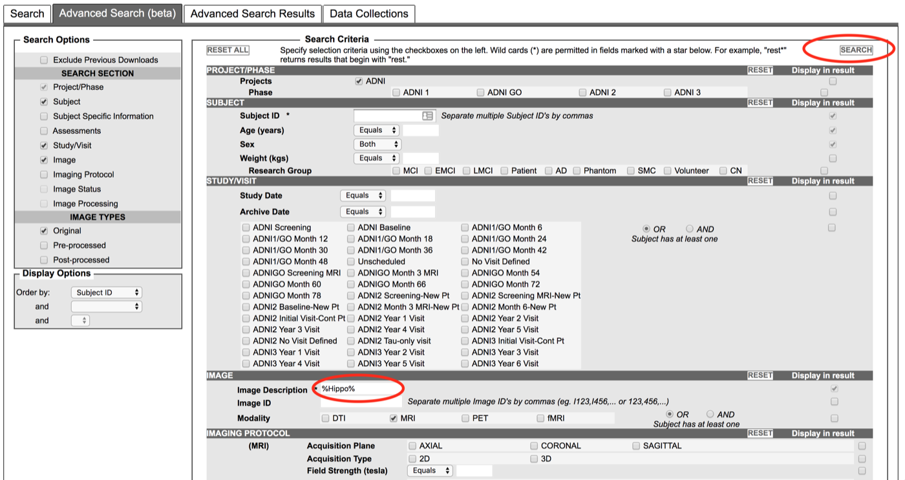

# ADNI3 Data

## High-resolution imaging of the medial temporal lobe in ADNI3

The [Alzheimer's Disease Neuroimaging Initiative (ADNI)](http://adni.loni.usc.edu/) has collected thousands of oblique coronal T2-weighted MRI scans, with multiple time points per participant. This dataset is an excellent resource for testing hypotheses involving effects of Alzheimer's disease and related dementias on hippocampal subfields and MTL subregions.

This page describes how to access these scans, their quality assessments (QA), and automated segmentations of MTL subregions generated using ASHS. These instructions assume that you have registered for access to ADNI data.

## Obtaining the imaging data

- Go to the ADNI data site: <https://ida.loni.usc.edu/login.jsp?project=ADNI&page=HOME>
- In the top menu, select **Download → Image Collections**
- Select the **Advanced Search (Beta)** tab
- In the search interface, under **Image Description**, enter **%Hippo%** then press **Search**

<figure markdown>

</figure>

- You will see a list of about 2200 scans (at the time of this writing)
- Press the **Select All** checkbox and **Add to Collection**
- Follow the prompts to download your collection

## Obtaining scan QA scores and ASHS-derived measures

These T2-weighted images have been examined and assigned a QA score by ADNI researchers at the [PICSL group at the University of Pennsylvania](https://picsl.upenn.edu). The scans were then processed using ASHS with the "PMC Clinical" atlas.

- Go to the ADNI data site: <https://ida.loni.usc.edu/login.jsp?project=ADNI&page=HOME>
- In the top menu, select **Download → Study Data**
- Search for documents with "ASHS" in the title
    - Please read the documentation in **"ASHS volume data methods (PDF)"**
    - The QA scores and volume measurements are in the spreadsheet **"ASHS volume data [ADNI1,GO,2,3]"**
    - The spreadsheet **"ASHS volume data Dictionary [ADNI1,GO,2,3]"** contains additional metadata about the fields in the main spreadsheet
- Using the QA scores:
    - QA scores are in columns `T2_QC_R` and `T2_QC_L` (separate for left/right MTL)
    - Scores are from 0 (worst) to 4 (best). ***Images with quality 0 or 1 should not be used.***
- Using the ASHS quantitative results:
    - Columns `RIGHT_XXX_VOL` and `LEFT_XXX_VOL` give ASHS-derived MTL subregional volumes
    - Columns `RIGHT_XXX_NS` and `LEFT_XXX_NS` give the number of slices occupied by the MTL subregions
    - *We recommend normalizing the volume of extrahippocampal structures (ERC, BA35, BA36, PHC) by the number of slices, as in the ASHS 2014 HBM paper.*
- We also recommend reading the general **"ADNI3 MRI ANALYSIS MANUAL (PDF)"** document.
