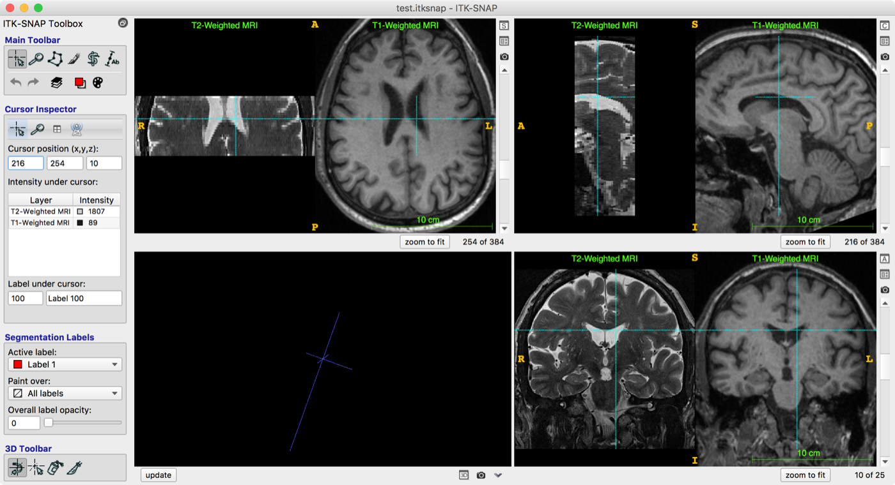
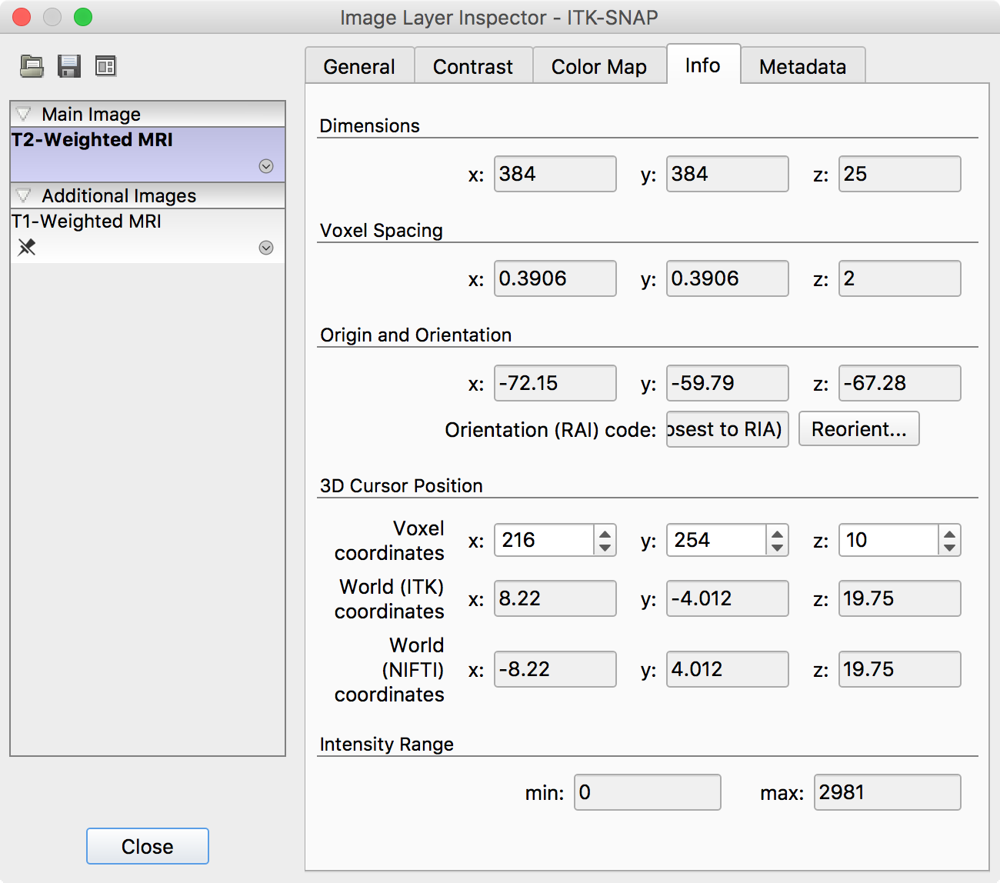

# MRI Requirements: ASHS-PMC Atlas

## Overview

This page describes the MRI data requirements for using ASHS with the ASHS-PMC atlas. This atlas is used to automatically segment **hippocampal subfields** and extrahippocampal **medial temporal lobe subregions** ERC, BA35, BA36 and PHC.

This requires **high-resolution T2-weighted MRI** in which the layers of the hippocampus can be visually separated. A whole-brain T1-weighted MRI scan is also required to run ASHS.

## MRI requirements

To use the ASHS-PMC atlas, your data must meet these specifications:

- **T2-weighted MRI:**
    - voxel size 0.4 mm × 0.4 mm × 2.0 mm or similar
    - oblique coronal slices perpendicular to the main axis of the hippocampus
    - covers the length of the hippocampus
- **T1-weighted MRI:**
    - voxel size 1.0 mm × 1.0 mm × 1.0 mm or similar
    - whole brain coverage, not skull stripped
- T1 and T2-weighted MRI are roughly aligned in space

In addition, your subjects should be older adults (55+).

<figure markdown>

<figcaption>MRI scans for the ASHS-PMC atlas.</figcaption>
</figure>

## Checking MRI requirements using ITK-SNAP

We recommend using [ITK-SNAP](http://itksnap.org) 3.6.2 or later to examine the datasets as described below.

1. Load the T2-weighted MRI as the "Main Image" in ITK-SNAP
    - From the menu select `File->Open Main Image...`
2. Load the T1-weighted MRI as the "Additional Image"
    - `File->Add Another Image...`
3. Make sure that the T1 and T2-weighted images are properly aligned
    - The images in the figure below are well aligned
    - If the images are not properly aligned, [use the registration tool](https://www.youtube.com/watch?v=RT_M_EPzdyY) to perform rigid registration (align the T1-weighted MRI to the T2)
    - Save the resulting transformation in Convert3D format
4. Make sure that the T2 image is correctly encoded
    - Examine image properties using `Tools->Image Information...`
    - Make sure that the *x* and *y* dimensions of the T2-weighted image are larger than the *z* dimension (e.g., 384 × 384 × 25 as in the figure below)
    - If this is not the case, use the [convert3d -swapdim](https://github.com/pyushkevich/c3d/blob/master/doc/c3d.md#-swapdim-reorder-the-coordinate-axes-of-an-image) command to reorient the images

<figure markdown>

<figcaption>T2-weighted MRI and T1-weighted MRI side by side in ITK-SNAP. In this example the two modalities are well aligned.</figcaption>
</figure>

<figure markdown class="fig-narrow">

<figcaption>The ITK-SNAP Image Information dialog, showing the dimensions of the T2-weighted image.</figcaption>
</figure>
