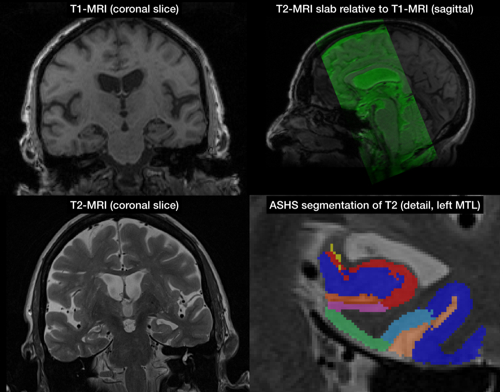
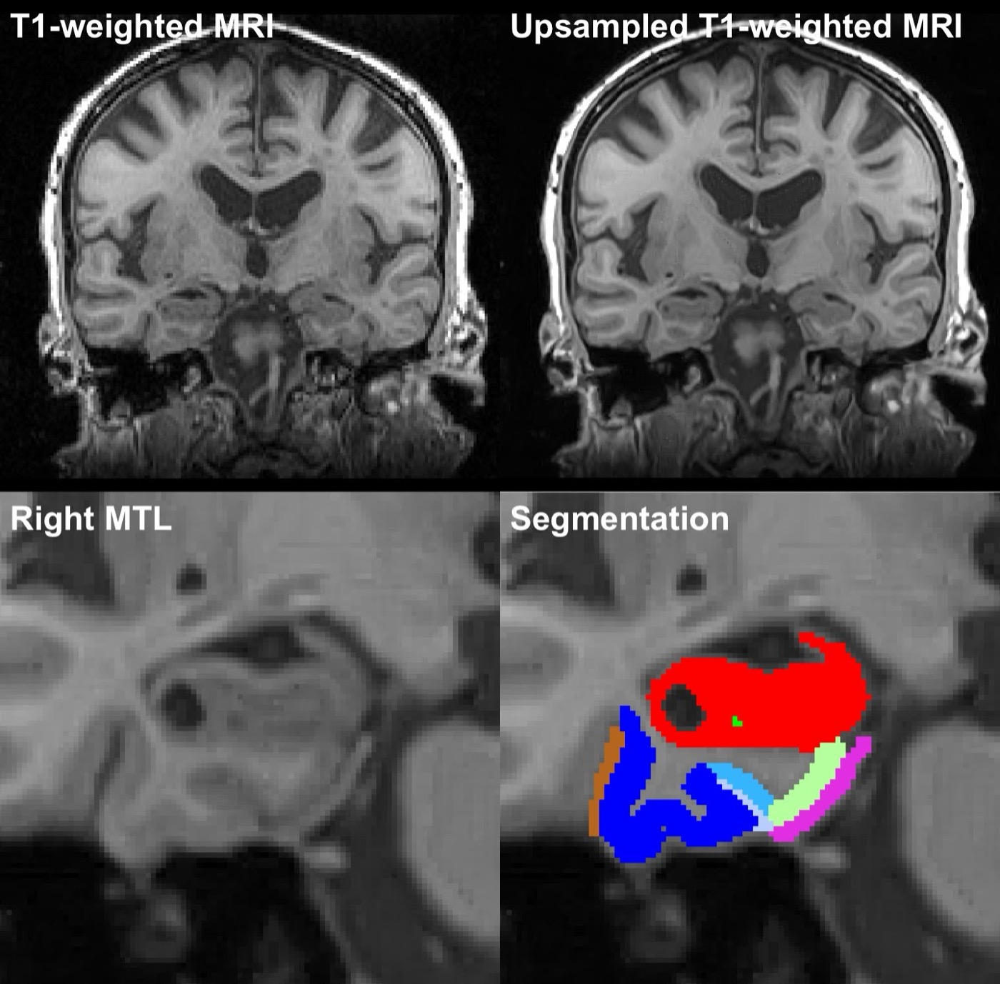

# ASHS Quick Start

This section is organized as a series of questions to help you get started with ASHS.

## 1. Pick the ASHS atlas that is best for your data

Most users will run ASHS using one of the existing atlases that we provide. However, for this to work, your MRI scans must be sufficiently similar to the MRI scans used to form the atlas. Currently, the following atlases are available for ASHS:

### ASHS-PMC: Penn Memory Center T2-weighted 3T MRI Atlas

Use this atlas if:

- Your MRI protocol includes
    - T2-weighted MRI of approximately 0.4 × 0.4 × 2.0 mm³ resolution, with slices orthogonal to the main axis of the hippocampus (see figure)
    - T1-weighted MRI of approximately 1.0 × 1.0 × 1.0 mm³ resolution
- You wish to segment hippocampal subfields and extrahippocampal MTL subregions
- You are studying older adults (studies of aging and early neurodegenerative diseases)

<figure markdown>

<figcaption>Input data and segmentation for the ASHS-PMC atlas.</figcaption>
</figure>

### ASHS-PMC-T1: Penn Memory Center T1-Only Atlas for T1-weighted 3T MRI

Use this atlas if:

- Your MRI protocol includes only whole-brain T1-weighted MRI (no high-resolution T2)
- You wish to segment extrahippocampal MTL subregions (ERC, BA35, BA36 and PHC) and the whole hippocampus (only anterior/posterior, not hippocampal subfields)
- You are studying older adults (studies of aging and early neurodegenerative diseases)

<figure markdown>

<figcaption>Input data and segmentation for the ASHS-PMC-T1 atlas.</figcaption>
</figure>

### ASHS-Utrecht: Utrecht Medical Center 7T MRI Atlas

Use this atlas if:

- Your data is similar to the protocol described in [Wisse et al., 2016](../resources/citations.md).

### Build a Custom Atlas

If none of the atlases above suit your needs, you can build your own atlas. You will need:

- MRI data from 20–30 representative subjects with manual segmentations
- Access to a high-performance computing (HPC) Linux cluster

See [Building an Atlas for T2-MRI](local/atlas-t2.md) and [Building an Atlas for T1-MRI](local/atlas-t1.md).

## 2. Verify that your MRI data is suited for ASHS

Check that your data meet the requirements for the atlas you choose:

- [ASHS-PMC Atlas](mri-data/pmc-atlas.md)
- [ASHS-PMC-T1 (T1-only) Atlas](mri-data/pmc-t1-atlas.md)
- ASHS-Utrecht Atlas

## 3. Choose how to run ASHS

If you are using an existing atlas, you can run ASHS in two ways:

- By sending your data to a cloud-based server that runs ASHS for you (the easy way)
    - [Preliminary steps](cloud/index.md)
    - [Instructions for the ASHS-PMC atlas](cloud/t2-mri.md)
    - [Instructions for the ASHS-PMC-T1 (T1-only) atlas](cloud/t1-mri.md)
- By [installing ASHS on your Linux or MacOS computer](local/installation.md) (the slightly harder way)

If you are building a custom atlas, you will need to install ASHS on an HPC cluster.
