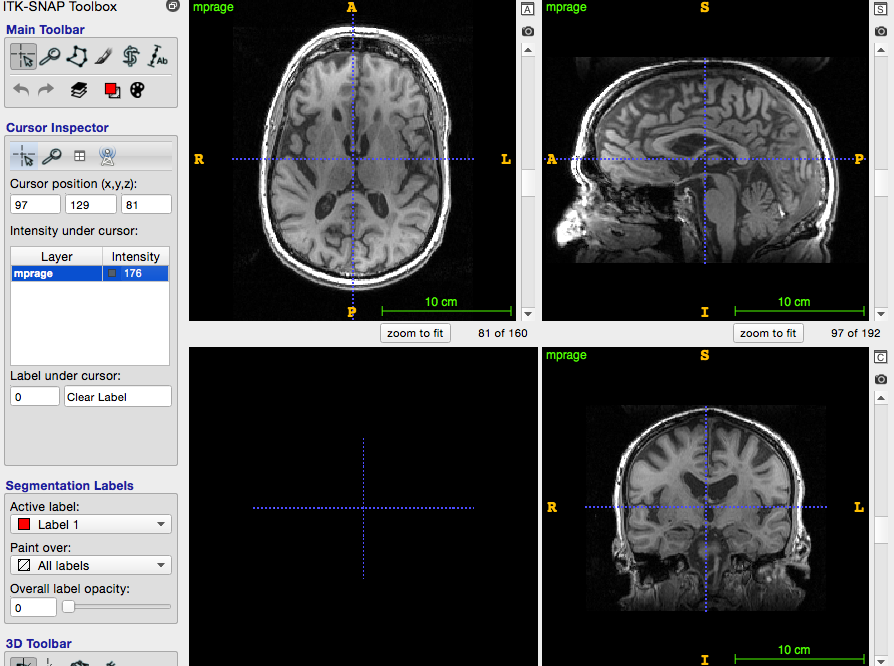

# Cloud HyperASHS Tutorial: T1-MRI

This tutorial uses the **HyperASHS-PMC-T1** service. Make sure that your [MRI data is compatible](../mri-data/t1-model.md) with this model. The procedure is very similar to the one for [T2-weighted and T1-weighted MRI](t2-mri.md).

!!! note "ITK-SNAP 4.6 or later is required"
    HyperASHS returns segmentations at a finer resolution than the input MRI, i.e., in a different voxel space from the main image. Only [ITK-SNAP 4.6](http://www.itksnap.org/pmwiki/pmwiki.php?n=Downloads.SNAP4) and later can work with such segmentations, so older versions of ITK-SNAP cannot be used with Cloud HyperASHS.

## 1. Create an ITK-SNAP workspace

To send your images to the cloud, you need to create an ITK-SNAP workspace that contains the T1-weighted image.

- Open ITK-SNAP
- Use `File->Open Main Image...` to load the **T1-weighted image** as the main image
- Save the ITK-SNAP workspace to a file using `Workspace->Save Workspace`

<figure markdown>

<figcaption>ITK-SNAP with a T1-weighted image loaded as the main image.</figcaption>
</figure>

## 2. Log in to the Distributed Segmentation Service (DSS)

Log in to the DSS server with your Google account, exactly as described in [step 2 of the T2-MRI tutorial](t2-mri.md#2-log-in-to-the-distributed-segmentation-service-dss): open `Tools->Distributed Segmentation Service`, press **Get Token**, log in on the web page, and paste the token back into ITK-SNAP.

## 3. Upload your workspace and create a ticket

- Select the "Submit" tab in the ITK-SNAP DSS window
- Select the **HyperASHS-PMC-T1** service from the list
- Make sure that the T1-weighted image is assigned to the "T1-MRI" tag
- Press **Submit**. The workspace will be uploaded to the server and a new ticket will be created.

## 4. Monitor ticket status

The DSS window switches to the "Results" tab, where you can monitor the progress of your ticket. The ticket states and QC attachments are described in [step 4 of the T2-MRI tutorial](t2-mri.md#4-monitor-ticket-status).

## 5. Download and examine the results

Once a ticket is in the **success** state, select it and press **Download** to save the result workspace and, optionally, open it in ITK-SNAP. See [Outputs](../usage.md#outputs) for a description of the HyperASHS results.
