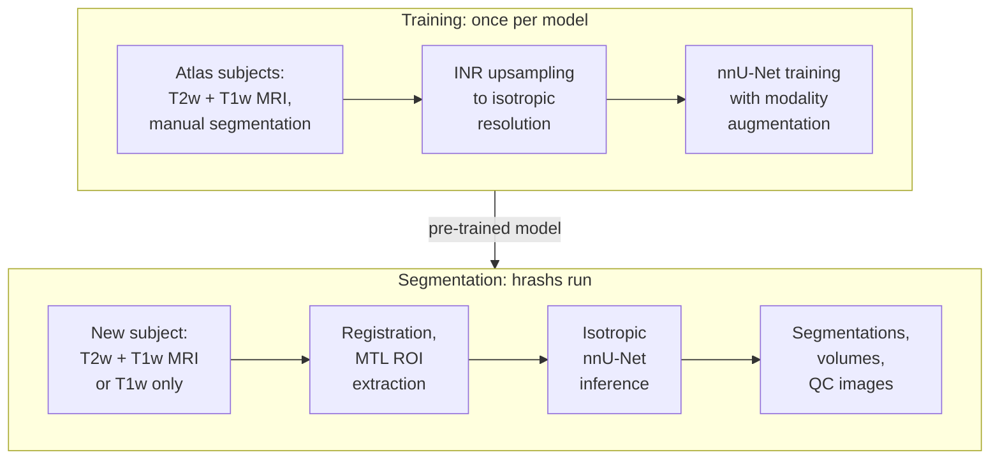

# HyperASHS

HyperASHS is the new generation of ASHS. It segments hippocampal subfields and the subregions of the medial temporal lobe (MTL) cortex from 3T MRI, using a deep learning model trained on **isotropic, hyper-resolution** versions of the ASHS atlases.

- Produces segmentations at nearly isotropic resolution (e.g., 0.4 × 0.4 × 0.4 mm³) from anisotropic T2-weighted MRI (e.g., 0.4 × 0.4 × 2.0 mm³). There are no "staircase" artifacts along the slice direction, so thickness and shape can be measured reliably.
- Uses both T2-weighted and T1-weighted MRI, or T1-weighted MRI alone.
- The T2w + T1w and T1w-only models share a **unified segmentation protocol**, so results are consistent across the two kinds of data.
- Runs [in the cloud](cloud/index.md) through ITK-SNAP, or locally: it is Python-based and installed with `pip install hyperresashs`. A segmentation takes about 3 minutes on a GPU.
- Pre-trained models are downloaded automatically from Hugging Face.
- Can be [retrained](training.md) on your own manual segmentations.
- Free and open-source.

<figure markdown>

<figcaption>HyperASHS segmentation of hippocampal subfields and MTL cortex from T2w + T1w MRI (PMC_Atlas model).</figcaption>
</figure>
<figure markdown>

<figcaption>HyperASHS segmentation of anterior/posterior hippocampus and MTL cortex from T1w MRI only (PMC_T1_Atlas model).</figcaption>
</figure>

## How it works

ASHS atlases are built from manual segmentations of T2-weighted MRI with thick slices. HyperASHS first turns each atlas subject into an isotropic training example. An *implicit neural representation* (INR) is fitted jointly to the subject's T2w MRI, T1w MRI and manual segmentation, and then sampled on a fine isotropic grid. An [nnU-Net](https://github.com/MIC-DKFZ/nnUNet) model is then trained on these upsampled images. When you segment a new subject, the T1w and T2w scans are registered, cropped around each hippocampus and upsampled, and the trained model labels them directly at isotropic resolution.

In the [paper](../resources/citations.md#hyperashs) describing the method, thickness and volume measures from the isotropic model separated people with mild cognitive impairment from cognitively unimpaired people with larger effect sizes than models trained on anisotropic data, and were more stable in test-retest scans.

## Available models

| Model ID | Input MRI | Structures | Population |
|---|---|---|---|
| `PMC_Atlas` | T2w (~0.4 × 0.4 × 2.0 mm³) + T1w (~1 mm³) | Hippocampal subfields, anterior MTL, amygdala, ERC, BA35, BA36, PHC | Older adults, neurodegenerative disease |
| `PMC_T1_Atlas` | T1w only (~1 mm³) | Anterior/posterior hippocampus, amygdala, ERC, BA35, BA36, PHC | Older adults, neurodegenerative disease |
| `HSG_Body_Atlas` | T2w + T1w | Hippocampal subfields in the hippocampal body (HSG harmonized protocol) | See `hrashs desc HSG_Body_Atlas` |

Run `hrashs list` to see the current list of models, and `hrashs desc <model_id>` for details. See the [Quick Start](quick-start.md) to choose one.

## Getting started

-   **[Quick Start](quick-start.md)**

    Pick a model, check your MRI data and run your first segmentation.

-   **[Cloud HyperASHS](cloud/index.md)**

    Send your scans to our server from ITK-SNAP. No installation needed.

-   **[Installation](installation.md)**

    Install HyperASHS from PyPI on a Linux workstation with an NVIDIA GPU.

-   **[Basic Usage](usage.md)**

    Run `hrashs run` and understand the outputs and QC images.

-   **[Training a Model](training.md)**

    Train HyperASHS on your own manual segmentation protocol.

## About us

HyperASHS is developed by members of the [Penn Image Computing and Science Laboratory (PICSL)](https://picsl.upenn.edu/) in the Department of Radiology at the University of Pennsylvania. The source code is on [GitHub](https://github.com/pyushkevich/HyperResASHS).
