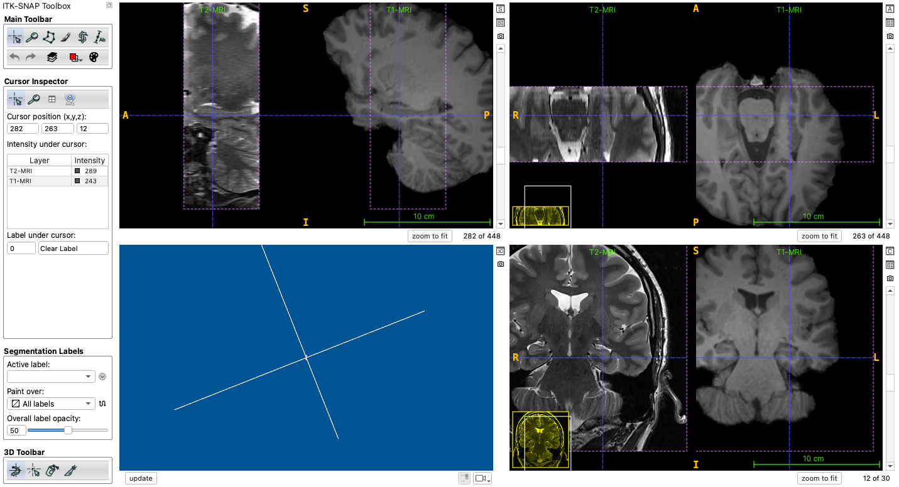
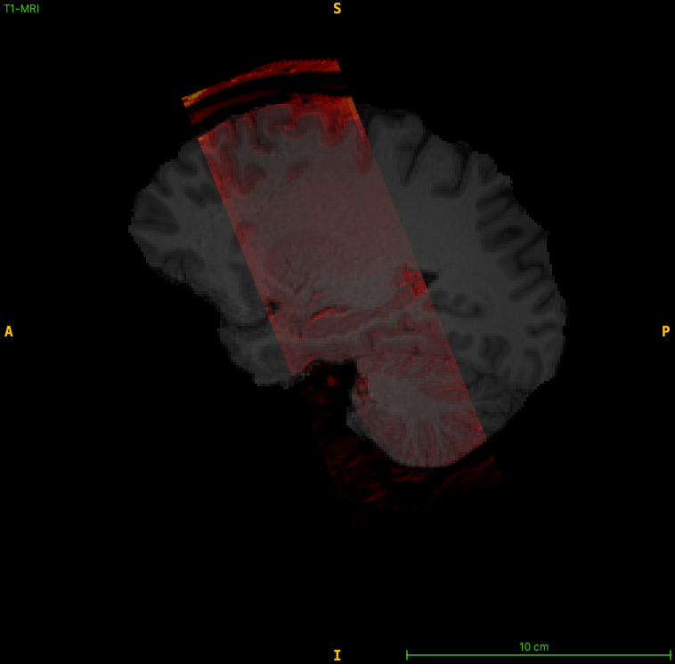

# MRI Requirements: T2w + T1w Models

## Overview

This page describes the MRI data requirements for the HyperASHS models that use both T2-weighted and T1-weighted MRI: `PMC_Atlas` and `HSG_Body_Atlas` (which follows the [harmonized protocol of the Hippocampal Subfields Group](https://hippocampalsubfields.com/) for the hippocampal body). These models segment **hippocampal subfields** and the extrahippocampal **medial temporal lobe subregions** ERC, BA35, BA36 and PHC.

This requires **high-resolution T2-weighted MRI** in which the layers of the hippocampus can be visually separated. A whole-brain T1-weighted MRI scan is also required. HyperASHS uses the T1w scan to locate the hippocampus, and also as a second input to the segmentation model, which helps along the thick-slice direction of the T2w scan.

## MRI requirements

Your data should meet these specifications:

- **T2-weighted MRI** (usually a turbo spin echo, TSE, scan):
    - voxel size of about 0.4 mm × 0.4 mm in-plane, with slices 1.2–2.6 mm thick
    - oblique coronal slices perpendicular to the main axis of the hippocampus
    - covers the length of the hippocampus (a partial-brain slab is fine)
- **T1-weighted MRI** (e.g., MPRAGE):
    - voxel size of about 1.0 mm × 1.0 mm × 1.0 mm or finer
    - whole brain coverage, not skull stripped
- 3 Tesla field strength

In addition, the PMC_Atlas model was trained on older adults (55+) and is intended for studies of aging and neurodegenerative disease.

Unlike ASHS Classic, HyperASHS registers the T1w scan to the T2w scan automatically, so the two scans do not need to be aligned beforehand. If automatic registration fails, you can supply your own transform with `--reg-t1t2` (see [Basic Usage](../usage.md#registration-options)).

<figure markdown>

<figcaption>T2-weighted MRI (left) and T1-weighted MRI (right) suitable for the PMC_Atlas model.</figcaption>
</figure>

<figure markdown class="fig-narrow">

<figcaption>Position of the T2-weighted slab on a sagittal slice of the T1-weighted MRI. The slices are perpendicular to the main axis of the hippocampus and cover its full length.</figcaption>
</figure>

## Checking your data using ITK-SNAP

We recommend using [ITK-SNAP](http://www.itksnap.org/pmwiki/pmwiki.php?n=Downloads.SNAP4) 4.6 or later to examine your scans before running HyperASHS.

1. Load the T2-weighted MRI as the main image (`File->Open Main Image...`)
2. Load the T1-weighted MRI as an additional image (`File->Add Another Image...`)
3. Check that the T2w slices are oblique coronal, perpendicular to the long axis of the hippocampus, and that they cover the whole hippocampus, from the amygdala to the tail
4. Check the voxel size and dimensions of each image with `Tools->Image Information...`
