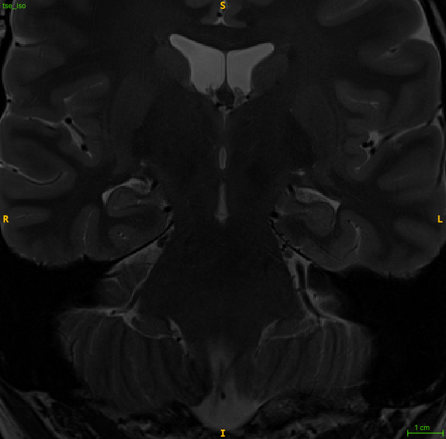
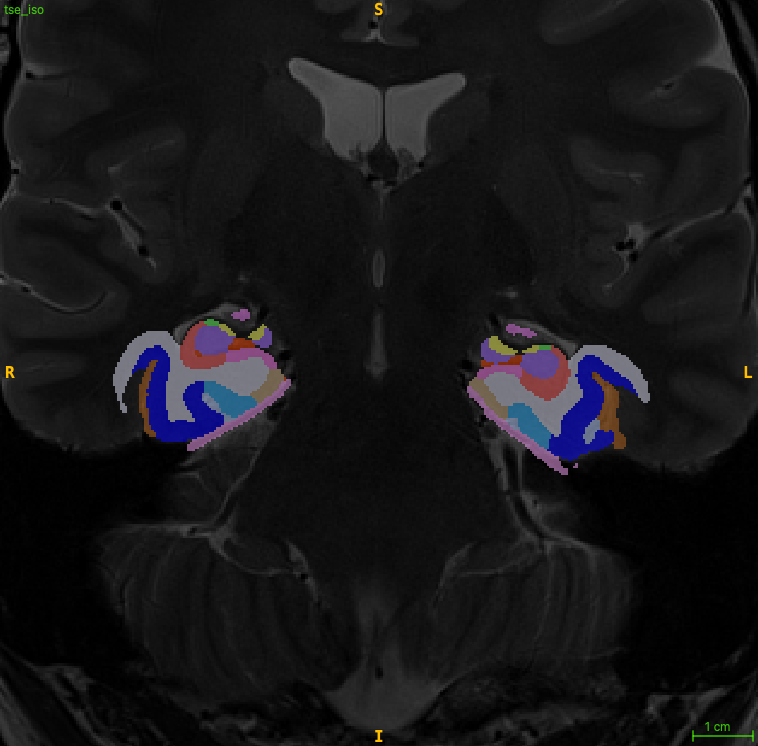
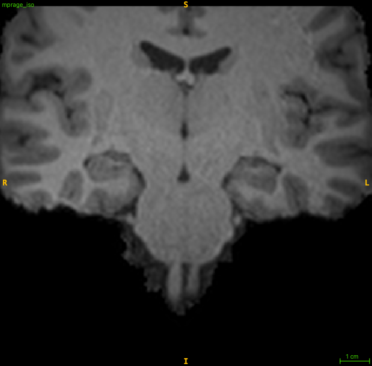
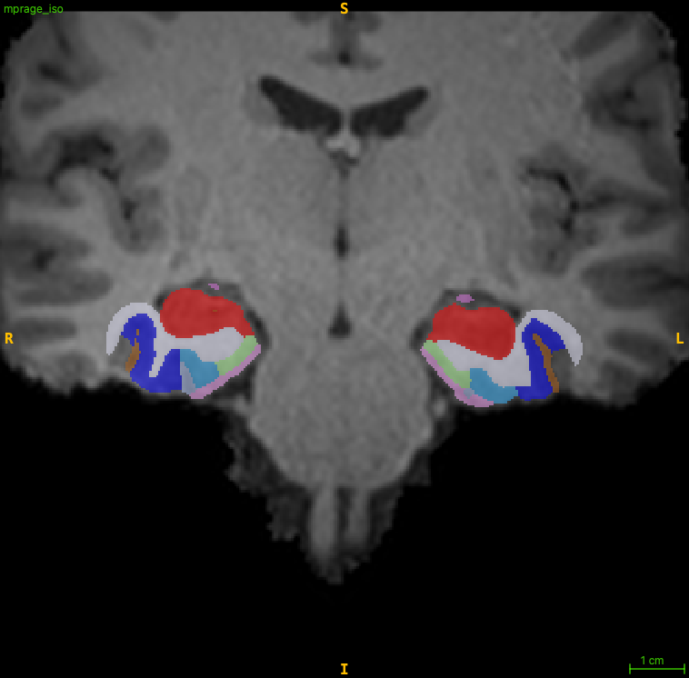

# HyperASHS Quick Start

This section is organized as a series of questions to help you get started with HyperASHS.

## 1. Pick the HyperASHS model that is best for your data

Most users will run HyperASHS with one of the pre-trained models that we provide. For this to work, your MRI scans must be sufficiently similar to the scans used to train the model. Currently, the following models are available:

### PMC_Atlas: Penn Memory Center T2w + T1w 3T MRI model

Use this model if:

- Your MRI protocol includes
    - T2-weighted MRI of approximately 0.4 × 0.4 × 2.0 mm³ resolution, with slices orthogonal to the main axis of the hippocampus
    - T1-weighted MRI of approximately 1.0 × 1.0 × 1.0 mm³ resolution
- You wish to segment hippocampal subfields and extrahippocampal MTL subregions
- You are studying older adults (studies of aging and early neurodegenerative diseases)

<div class="fig-row" markdown>
<figure markdown>

<figcaption>Input T2-weighted MRI, upsampled to the resolution of the segmentation.</figcaption>
</figure>
<figure markdown>

<figcaption>HyperASHS segmentation with the PMC_Atlas model.</figcaption>
</figure>
</div>

### PMC_T1_Atlas: Penn Memory Center T1w-only 3T MRI model

Use this model if:

- Your MRI protocol includes only whole-brain T1-weighted MRI (no high-resolution T2)
- You wish to segment extrahippocampal MTL subregions (ERC, BA35, BA36 and PHC), the amygdala and the hippocampus (anterior/posterior, but not hippocampal subfields)
- You are studying older adults (studies of aging and early neurodegenerative diseases)

This model uses the same segmentation protocol as PMC_Atlas, so measures of the MTL cortex are consistent between the two models.

<div class="fig-row" markdown>
<figure markdown>

<figcaption>Input T1-weighted MRI, upsampled to the resolution of the segmentation.</figcaption>
</figure>
<figure markdown>

<figcaption>HyperASHS segmentation with the PMC_T1_Atlas model.</figcaption>
</figure>
</div>

### HSG_Body_Atlas: Hippocampal Subfields Group body model

Use this model if:

- You have T2w + T1w MRI as for PMC_Atlas, and
- You want hippocampal subfields in the hippocampal body, following the harmonized protocol of the [Hippocampal Subfields Group](http://hippocampalsubfields.com/)

### Train a custom model

If none of the models above suit your needs, you can train your own. You will need:

- MRI data from 20–30 representative subjects with manual segmentations
- A Linux computer with an NVIDIA GPU

See [Training a Model](training.md).

## 2. Verify that your MRI data is suited for HyperASHS

Check that your data meet the requirements for the model you choose:

- [PMC_Atlas (T2w + T1w) model](mri-data/t2-t1-model.md)
- [PMC_T1_Atlas (T1w only) model](mri-data/t1-model.md)

## 3. Install and run HyperASHS

HyperASHS runs on your own computer. A Linux computer with an NVIDIA GPU is strongly recommended. A segmentation takes about 3 minutes on a GPU, but over an hour on a CPU.

1. [Install HyperASHS](installation.md):

    ```bash
    pip install hyperresashs
    hrashs check
    ```

2. [Run the segmentation](usage.md):

    ```bash
    # T2w + T1w MRI
    hrashs run -a PMC_Atlas -g t1.nii.gz -f t2.nii.gz -I sub01 -w ./sub01

    # T1w MRI only
    hrashs run -a PMC_T1_Atlas -g t1.nii.gz -I sub01 -w ./sub01
    ```

There is no cloud service for HyperASHS yet. If you do not have access to a GPU, you can still use [Cloud ASHS](../ashs/cloud/index.md) with the classic ASHS atlases.
