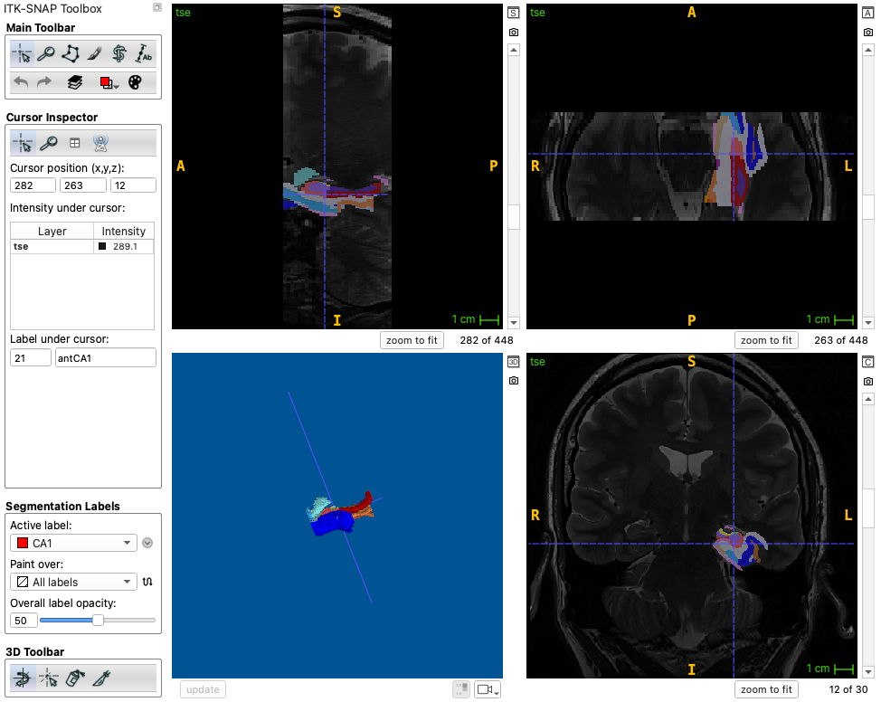

# HyperASHS: Basic Usage

!!! info "Before you start"
    Complete the [installation](installation.md) and make sure that your [MRI data is compatible](mri-data/index.md) with the model you plan to use.

## Overview

HyperASHS has a command-line interface, `hrashs`, for running segmentation on new subjects with pre-trained models. Models are downloaded from Hugging Face automatically the first time you use them.

## 1. List available models

View all the pre-trained models available for download:

```bash
hrashs list
```

This displays the model IDs, names, and a brief description of each model. Add `-l` for more detail.

## 2. View model details

Get detailed information about a specific model, including the required inputs, their expected resolution, and the papers to cite:

```bash
hrashs desc PMC_Atlas
```

## 3. Run segmentation

Run segmentation on your subject's data:

```bash
hrashs run -a <model_id> -g <t1_image> -f <t2_image> -w <workdir>
```

For example, using T2w + T1w MRI and four threads:

```bash
hrashs run -a PMC_Atlas -g sub01_mprage.nii.gz -f sub01_tse.nii.gz -I sub01 -w ./output/sub01 -t 4
```

To segment T1-weighted MRI only, omit the `-f` option and use a T1w model:

```bash
hrashs run -a PMC_T1_Atlas -g sub01_mprage.nii.gz -I sub01 -w ./output/sub01 -t 4
```

!!! note
    The `-g` and `-f` options are the same as in ASHS Classic: `-g` is the T1-weighted (MPRAGE) image and `-f` is the T2-weighted (TSE) image. Unlike ASHS Classic, do not pass the T1w image to both options for T1-only segmentation. Just leave out `-f`.

**Required arguments:**

| Option | Description |
|---|---|
| `-a, --atlas` | Model ID (see `hrashs list`) or path to a model directory or config file |
| `-g, --t1` | Path to the T1-weighted (MPRAGE) image |
| `-f, --t2` | Path to the T2-weighted (TSE) image. Omit to run in T1-only mode |
| `-w, --workdir` | Output directory for results |

**Optional arguments:**

| Option | Description |
|---|---|
| `-I, --subject-id` | Subject ID, which will be prefixed to all output filenames |
| `-t, --threads` | Number of parallel threads for registration, etc. [default: 1] |
| `--device` | Device for computation (`cuda` or `cpu`) [default: auto]. To select specific GPUs, set the `CUDA_VISIBLE_DEVICES` environment variable |
| `--reg-t1t2` | Use this T1w-to-T2w transform instead of automatic registration (see [below](#registration-options)) |
| `--reg-t1t2-identity` | Do not register T1w to T2w; trust the image headers instead |
| `-N, --no-overwrite` | Do not overwrite existing results |
| `-L, --no-links` | Copy the input files into the working directory instead of creating symbolic links |
| `-T, --tidy` | Reduce the number of intermediate files |
| `-k, --disable-ssl-verification` | Disable SSL verification for Hugging Face (e.g., behind a corporate proxy) |

## Outputs

Segmentation results are saved in the `final` subdirectory of the working directory:

```console
$ ls output/sub01/final
sub01_hyperres_volumes.csv
sub01_itksnap_labels.txt
sub01_tse_native_seg_left.nii.gz
sub01_tse_native_seg_right.nii.gz
sub01_tse_patch_hyperres_seg_left.nii.gz
sub01_tse_patch_hyperres_seg_right.nii.gz
```

- `[subject]_tse_patch_hyperres_seg_[side].nii.gz`: the HyperASHS segmentations, at nearly isotropic resolution (e.g., 0.4 × 0.4 × 0.4 mm³). **We recommend using these images** for volumetry, thickness computation, running [CRASHS](https://github.com/pyushkevich/crashs), etc.
- `[subject]_tse_native_seg_[side].nii.gz`: the segmentations resampled to the space of the original T2-weighted MRI. They can be used for visualization or for computing similarity with manual segmentations. However, these segmentations have step-edge artifacts when the T2-weighted MRI is anisotropic.
- `[subject]_hyperres_volumes.csv`: the volume of each subregion, computed from the hyper-resolution segmentations, in mm³. The file has one row per subject, side and label:

    ```text
    subject,side,subfield,volume
    sub01,left,CA1,...
    ```

- `[subject]_itksnap_labels.txt`: the label description file, which gives the name and color of each label for ITK-SNAP.

The ASHS Classic outputs have three variants of each segmentation (`lfseg_heur`, `lfseg_corr_usegray`, `lfseg_corr_nogray`). HyperASHS produces a single segmentation per side.

## Quality control

Registration and segmentation QC images in PNG format are placed in the `qc` subdirectory of the working directory:

- `[subject]_registration_qc_[side].png`: coronal and sagittal slices of the T2w MRI, the registered T1w MRI and the registered template around each hippocampus, so you can check that they line up
- `[subject]_segmentation_qc_[side].png`: coronal and sagittal slices of the segmentation over the T2w and T1w MRI

Please review these images for every subject before using the results.

## Viewing the results in ITK-SNAP

To view the native-space segmentation over the T2-weighted MRI, type:

```bash
itksnap -g sub01_tse.nii.gz \
    -s output/sub01/final/sub01_tse_native_seg_left.nii.gz \
    -l output/sub01/final/sub01_itksnap_labels.txt
```

The results should look something like this:

<figure markdown>

<figcaption>HyperASHS segmentation of the left MTL in the space of the T2-weighted MRI, viewed in ITK-SNAP.</figcaption>
</figure>

To view the hyper-resolution segmentation, open it as the main segmentation over the T2-weighted MRI patch of the same side, which is placed in the working directory:

```bash
itksnap -g output/sub01/sub01_tse_patch_hyperres_left.nii.gz \
    -s output/sub01/final/sub01_tse_patch_hyperres_seg_left.nii.gz \
    -l output/sub01/final/sub01_itksnap_labels.txt
```

## Registration options

HyperASHS registers the T1w image to the T2w image automatically. If the QC images show that this registration failed, you can:

- Register the images yourself, e.g., with the registration tool in ITK-SNAP, using the **T2w MRI as the fixed image and the T1w MRI as the moving image**. Save the transform (in ITK-SNAP / Greedy / Convert3D format) and pass it with `--reg-t1t2 transform.mat`.
- If the scans were acquired in the same session and are already aligned in physical space, use `--reg-t1t2-identity` to skip the registration.

## Processing many subjects

`hrashs run` processes one subject at a time. To process a study, call it in a loop, e.g.:

```bash
for id in $(cat subjects.txt); do
  hrashs run -a PMC_Atlas -g data/${id}_t1.nii.gz -f data/${id}_t2.nii.gz \
    -I $id -w output/$id -t 4 -N
done
```

The `-N` option skips steps whose results already exist, so the loop can be restarted if it is interrupted.
