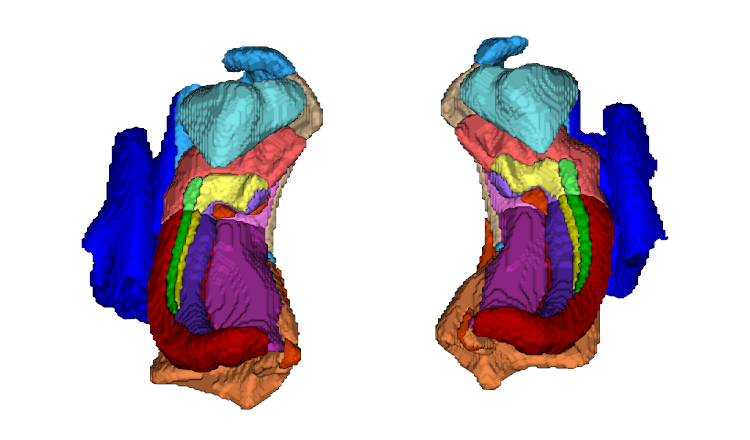
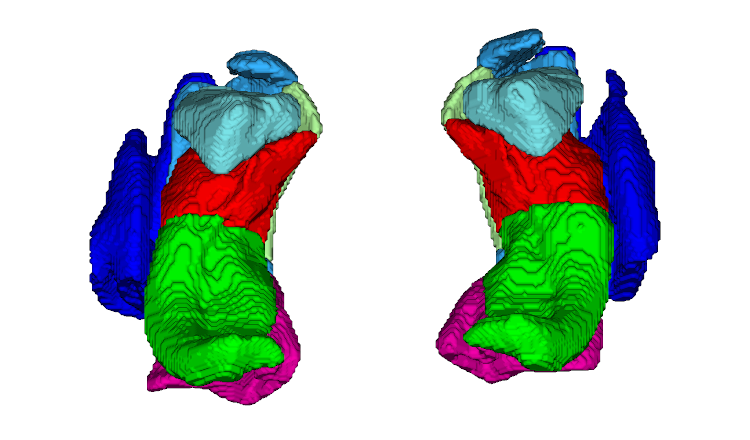
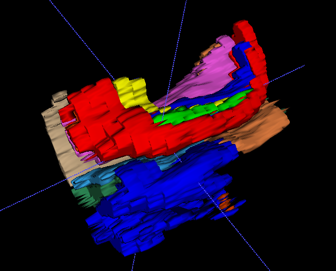

## What's new in 2026? HyperASHS!

HyperASHS is an all-new version of ASHS. It does much more than the original: it produces **isotropic-resolution** segmentations, it's **Python-based** and runs on a single GPU workstation, and its T2w + T1w and T1w-only models use a **unified protocol**. HyperASHS is described in our new paper in *NeuroImage*: [Li et al., 2026](https://doi.org/10.1016/j.neuroimage.2026.122294).

[Get started with HyperASHS](hyperashs/quick-start.md){ .md-button .md-button--primary }
[ASHS Classic documentation](ashs/index.md){ .md-button }

## What is ASHS?

ASHS is software for automatic segmentation of the medial temporal lobe (MTL) substructures in brain MRI scans. These structures are involved in early Alzheimer's disease and in a number of other neurological conditions. They are also important in research on memory and cognition.

- Automatically labels hippocampal subfields in T2-weighted MRI, or anterior/posterior hippocampus in T1-weighted MRI
- Automatically labels subregions of the MTL cortex, including entorhinal, perirhinal and parahippocampal cortex, in both T1-weighted and T2-weighted MRI
- Can be retrained to use your own segmentation protocol
- Free, open-source software

## Which version should I use?

**[HyperASHS](hyperashs/index.md)** (recommended) uses deep learning (nnU-Net) trained on isotropic, upsampled atlases. It produces segmentations at ~0.4 mm isotropic resolution and takes about 3 minutes per subject on an NVIDIA GPU. Install it with `pip install hyperresashs`.

**[ASHS Classic](ashs/index.md)** uses multi-atlas segmentation with joint label fusion. Its segmentations have the resolution of the T2w MRI. It runs in the cloud through ITK-SNAP, or locally on Linux and MacOS, and has been used in many published studies and in ADNI.

Use the **HyperASHS / ASHS Classic** switch at the top of every page to move between the two sets of documentation.

## About us

ASHS and HyperASHS are developed by members of the [Penn Image Computing and Science Laboratory (PICSL)](https://picsl.upenn.edu/) in the Department of Radiology at the University of Pennsylvania. Please see [Citations](resources/citations.md) for the papers to cite, and join the [mailing list](resources/mailing-list.md) for updates and help.

## Funding

Research reported on this website was supported by the National Institutes of Health under award numbers R01-AG056014, R01-AG037376, and R01-EB017255. The content is solely the responsibility of the authors and does not necessarily represent the official views of the National Institutes of Health.

<figure markdown>

<figcaption>HyperASHS segmentation of hippocampal subfields and MTL cortex from T2w + T1w MRI.</figcaption>
</figure>

<figure markdown>

<figcaption>HyperASHS segmentation of anterior/posterior hippocampus and MTL cortex from T1w MRI only.</figcaption>
</figure>

<figure markdown>

<figcaption>ASHS Classic segmentation from T2-weighted MRI.</figcaption>
</figure>

